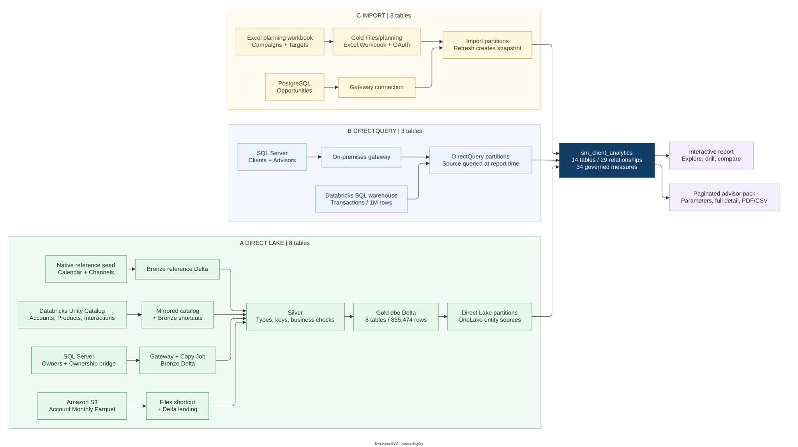

# RBC Client Analytics

### One governed analytical experience. Three deliberate data-access paths.

A reproducible, synthetic Microsoft Fabric and Power BI reference demo combining
Azure Databricks, SQL Server, PostgreSQL, Excel and Amazon S3. The customer
experience is a connected interactive report and a parameterized, print-ready
advisor pack, built on the same semantic model.

**14 business tables | 1,915,987 rows | 29 relationships | 34 measures**

> **Scope:** customer-facing reference implementation, not a production-certified
> deployment. All identities and amounts are synthetic. The original demo was
> exercised in November 2026; this portable package is locally validated, not
> evidence of a fresh deployment into every customer's tenant. See
> [validation and limitations](docs/validation.md) and [notice](NOTICE.md).



## Choose your route

| You want to... | Start here |
|---|---|
| Understand the architecture and every table's path | [Architecture and inventory](docs/architecture.md) |
| Inspect field types, keys and fact grain | [Complete data dictionary](docs/data-dictionary.md) |
| Re-create the demo in your own environment | [Deployment walkthrough](docs/deployment.md) |
| Load SQL, Databricks, PostgreSQL, Excel and S3 | [Source configuration](docs/sources.md) |
| Understand Direct Lake, DirectQuery and Import setup | [Semantic model and reports](docs/semantic-model.md) |
| Make Databricks access private | [Databricks VNet and Private Link](docs/databricks-vnet.md) |
| Present the customer demonstration | [Demo playbook](docs/demo-playbook.md) |
| Operate, govern, automate or troubleshoot it | [Operations and governance](docs/operations.md) |
| Know what was actually tested | [Validation and known limitations](docs/validation.md) |
| Open the verified 45-page synthetic output | [Sample advisor pack PDF](samples/advisor-pack.pdf) |

## The design in 60 seconds

| Access path | Tables | Why it exists |
|---|---|---|
| **Direct Lake on OneLake** | Eight curated Gold tables | Read Delta data without a traditional full Import copy; preserve a governed lakehouse layer. |
| **DirectQuery** | Transactions from Databricks; Clients and Advisors from SQL Server | Demonstrate querying external systems without importing these tables into the semantic model. |
| **Import** | Opportunities from PostgreSQL; Campaigns and Targets from Excel | Refresh snapshots of smaller operational/planning datasets for in-memory analysis. |

All paths converge in **`sm_client_analytics`**, not in chained semantic models.
Shared dimensions provide consistent slicing; explicit measures define AUM,
revenue, pipeline and plan attainment. This deliberate mixed-mode design is for
demonstration: it is not a recommendation to put every small dimension in DirectQuery.

## Included

- Full synthetic seed: Parquet, CSV and a real Excel workbook with named tables.
- Fail-if-exists SQL Server, PostgreSQL and Databricks source loaders.
- Parameterized Silver/Gold notebook generation with data-quality gates.
- Config-driven model generation: 8 Direct Lake / 3 DirectQuery / 3 Import.
- Interactive PBIR and paginated RDL report builders, including tested parameter
  and slicer fixes.
- First-deployment REST helper with a plan-only default and collision protection.
- Editable, XML-embedded draw.io SVG diagrams.
- Verified 45-page sample advisor pack PDF, with sanitized document metadata.
- Offline tests, dataset integrity checks, and a GitHub validation workflow.

## Local quick start

Use Python 3.12+; PowerShell 7 and Azure CLI are needed only for cloud commands.

```powershell
python -m venv .venv
.\.venv\Scripts\Activate.ps1
python -m pip install -r requirements.txt
python -B -m unittest discover -s tests -v
python -B tools\validate.py
Copy-Item config\environment.example.json config\environment.local.json
```

On macOS/Linux use `source .venv/bin/activate`. Fill in **your** resource IDs,
hostnames and database names following the [deployment guide](docs/deployment.md).
No password, OAuth token or private key belongs in the configuration file.

```powershell
# These commands only generate files. They do not provision or refresh anything.
python tools\build.py notebooks --config config\environment.local.json
python tools\build.py model --config config\environment.local.json
```

**There is no one-click deployment claim.** Tenant permissions, licensed capacity,
source infrastructure, source authentication, shortcuts/copy jobs and security
approvals are explicit prerequisites. The guide separates manual setup from
automated artifact generation and publication.

## Repository map

```text
config/       Target-environment template; local values are gitignored
data/         Curated synthetic seed, contract, checksums and source loaders
docs/         Architecture, deployment, private networking and operations
notebooks/    Spark cell source; build.py creates target-bound .ipynb files
src/          Reusable semantic-model and report builders
tools/        Local build/validation and explicit cloud publication/export
tests/        Portable generation and regression checks
samples/      Verified synthetic paginated output
.generated/   Your generated artifacts and deployment records (not committed)
```

The diagrams and procedures describe the implemented public-connectivity demo
and a **separate, documented private-network option**. No VNet was provisioned
as part of packaging this repository.

[Official reference index](docs/references.md) | [Contributing](CONTRIBUTING.md)
