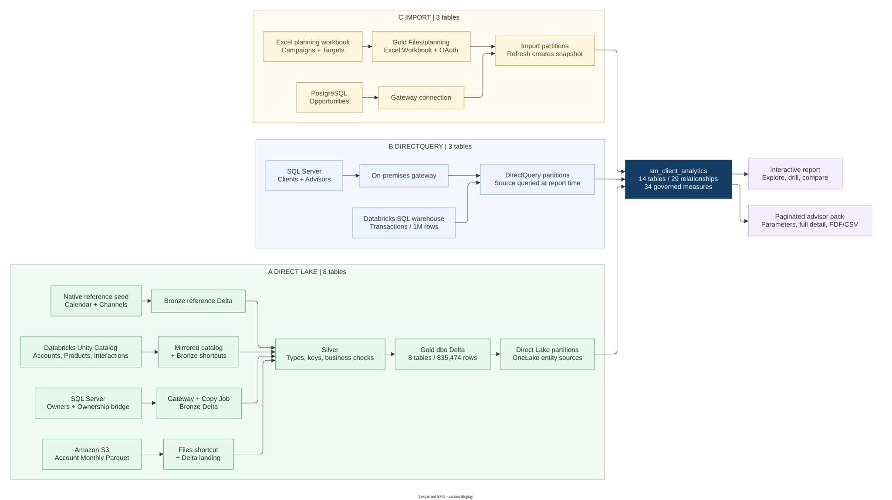
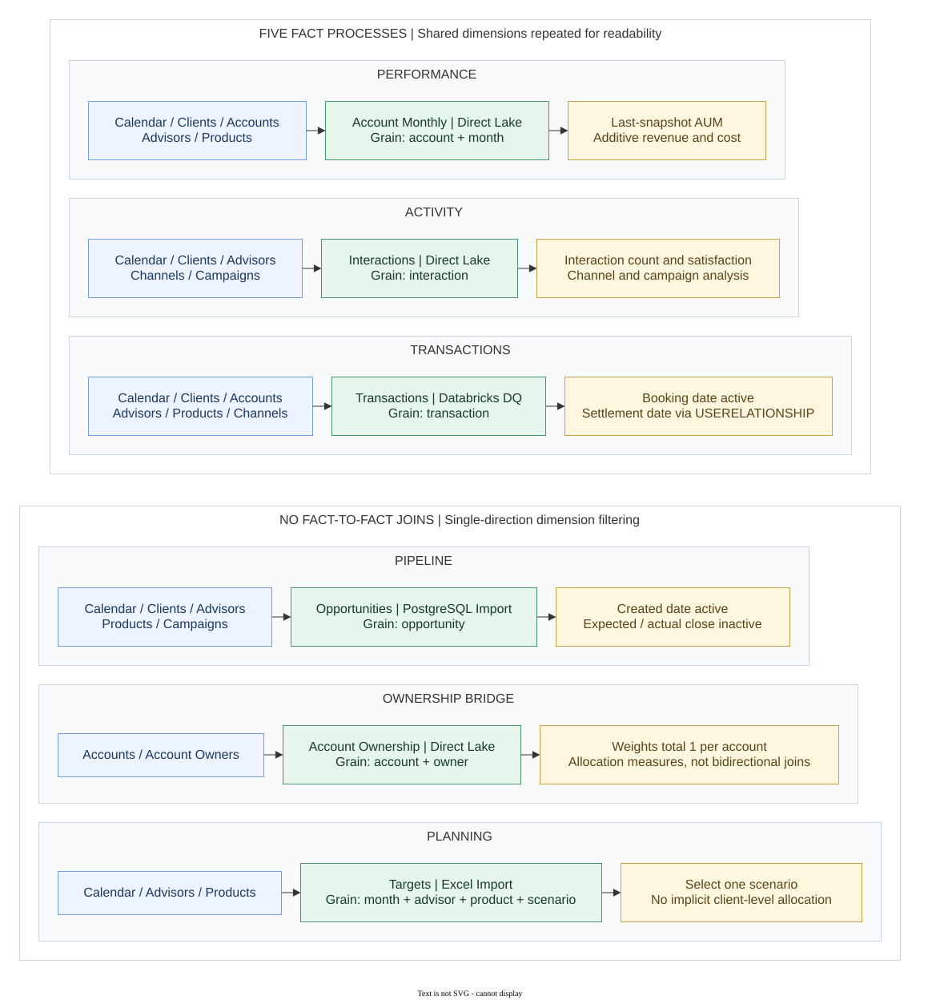

# Architecture and complete data inventory

[Home](../README.md) | [Deploy](deployment.md) | [Private networking](databricks-vnet.md)

## Architecture decisions

1. **One semantic model, multiple source systems.** We extended a Direct Lake on
   OneLake model with real DirectQuery and Import partitions. We did not use
   Desktop's "Make changes to this model" to build a second, chained model.
2. **One authoritative business source per table.** Bronze/Silver/Gold copies are
   processing stages, not extra business entities. A source may supply both a
   direct query path and a separate ingestion path for different tables.
3. **Eight curated Gold tables.** SQL Clients and Advisors intentionally remain
   DirectQuery; do not ingest them into Gold merely because an older all-lake
   design would have done so.
4. **Actual Excel Import.** The workbook is stored in OneLake `Files/planning`,
   then parsed with `Excel.Workbook`. A file in OneLake is not automatically a
   Direct Lake table.
5. **Source-specific security.** Authentication, network reachability and
   authorization are independent gates. A successful connection test is not
   proof of table access, correct folding or acceptable query performance.

## Inventory: source, landing, serving and semantic table

The fixed seed uses CAD and business dates January 2024 through October 2026.
The calendar extends through December 2027. There are 10,000 business clients
represented by 11,000 SCD2 client versions.

For each physical field, type, key and alternate date role, see the
[complete data dictionary](data-dictionary.md).

| Power BI table | Authoritative physical source | Bronze path | Semantic-model input | Mode | Rows |
|---|---|---|---|---|---:|
| Calendar | Fabric-generated `dim_date` | `lh_bronze_channel.dbo.dim_date` | Gold `dbo.dim_date` | Direct Lake | 1,461 |
| Channels | Fabric-generated `dim_channel` | `lh_bronze_channel.dbo.dim_channel` | Gold `dbo.dim_channel` | Direct Lake | 5 |
| Accounts | Databricks `<catalog>.ca_uc.dim_account` | `lh_bronze_uc.dbo.dim_account` shortcut | Gold `dbo.dim_account` | Direct Lake | 20,000 |
| Products | Databricks `<catalog>.ca_uc.dim_product` | `lh_bronze_uc.dbo.dim_product` shortcut | Gold `dbo.dim_product` | Direct Lake | 8 |
| Interactions | Databricks `<catalog>.ca_uc.fact_interaction` | `lh_bronze_uc.dbo.fact_interaction` shortcut | Gold `dbo.fact_interaction` | Direct Lake | 100,000 |
| Account Owners | SQL `ca_demo.dim_account_owner` | `lh_bronze_sql_onprem.ca_demo.dim_account_owner` | Gold `dbo.dim_account_owner` | Direct Lake | 10,000 |
| Account Ownership | SQL `ca_demo.bridge_account_owner` | `lh_bronze_sql_onprem.ca_demo.bridge_account_owner` | Gold `dbo.bridge_account_owner` | Direct Lake | 24,000 |
| Account Monthly | S3 `fact_account_monthly.parquet` | `lh_bronze_s3.dbo.fact_account_monthly` Delta landing | Gold `dbo.fact_account_monthly` | Direct Lake | 680,000 |
| Clients | SQL `ca_demo.dim_client` | Not required | SQL table through gateway | DirectQuery | 11,000 |
| Advisors | SQL `ca_demo.dim_advisor` | Not required | SQL table through gateway | DirectQuery | 100 |
| Transactions | Databricks `<catalog>.ca_dq.fact_transaction` | None | Databricks SQL warehouse | DirectQuery | 1,000,000 |
| Opportunities | PostgreSQL `ca_demo.fact_opportunity` | None | PostgreSQL connection | Import | 15,000 |
| Campaigns | Excel named table `dim_campaign` | None | Gold `Files/planning/Client_Analytics_Planning.xlsx` | Import | 13 |
| Targets | Excel named table `fact_target` | None | Same workbook | Import | 54,400 |

**Gold** means lakehouse `lh_ca_gold`. **Silver** means `lh_ca_silver`; it contains
the same eight business tables in `dbo`, with run-lineage metadata. Gold contains
835,474 business rows. Totals across the 14 business tables are 1,915,987, not a
count of unique clients and not a sum including layer copies.

The original SQL copy experiment also landed Clients and Advisors in Bronze.
Those redundant copies are not inputs to the final Silver/Gold or semantic
design. For a fresh deployment, copy only the two ownership tables.

## Path A: Direct Lake on OneLake

1. S3 Parquet is exposed through a **Files shortcut**, then materialized as Delta.
2. A **Mirrored Azure Databricks Catalog** exposes the three UC tables; OneLake
   shortcuts surface them in the UC Bronze lakehouse. This catalog integration
   exposes metadata/access to existing storage; it is not CDC replication.
3. A gateway-backed Copy Job lands the two SQL ownership tables.
4. The two native reference tables are loaded from the supplied Parquet seed.
5. Bronze-to-Silver validates types, keys, synthetic flags and business rules.
   Silver-to-Gold requires a successful, consistent Silver run.
6. Eight `EntityPartitionSource` partitions point to Gold `dbo` Delta tables.
   They use a shared `AzureStorage.DataLake` expression with hierarchical
   navigation. No SQL-endpoint DirectQuery fallback is implied by this design.

The materialization into Silver/Gold is a real data copy. Only the shortcut/
mirrored-catalog access leg avoids replication of the source table.

## Path B: DirectQuery

- **SQL:** Clients and Advisors query `Sql.Database(server, database)` through
  the standard on-premises gateway.
- **Databricks:** Transactions queries the SQL warehouse using
  `Databricks.Catalogs(host, httpPath, [Catalog=null, Database=null,
  Implementation="2.0"])`, followed by explicit catalog/schema/table navigation.
- Model partitions are set to `directQuery`; data is not imported by a model
  refresh. Query caching still applies. This is not a guaranteed real-time SLA.
- SQL gateway and Databricks warehouse availability, query folding and source
  concurrency directly affect the report.

## Path C: Import

- Opportunities uses `PostgreSQL.Database(server, database)` and imports the
  opportunity table through a configured connection.
- Campaigns and Targets use `AzureStorage.DataLake(...,
  [HierarchicalNavigation=false])` to find exactly one planning workbook, then
  `Excel.Workbook` and explicit type conversions.
- Refresh creates a model snapshot. Updating the Excel file or PostgreSQL does
  not update the report until the Import refresh succeeds.
- Use an explicit authenticated OneLake cloud connection for the workbook
  refresh. Default Direct Lake SSO alone was insufficient for this mixed model's
  Excel refresh.

## Semantic relationships, not a tangled single star

Five fact tables share conformed dimensions. Account Ownership is a bridge;
Account Owners is a separate current-owner role, not a duplicate of historical
Clients. The model has 26 active and 3 inactive many-to-one, single-direction
relationships, no fact-to-fact joins and no bidirectional bridge shortcuts.

| Fact/bridge | Relevant dimensions |
|---|---|
| Account Monthly | Calendar, Clients, Accounts, Advisors, Products |
| Transactions | Calendar, Clients, Accounts, Advisors, Products, Channels |
| Interactions | Calendar, Clients, Advisors, Channels, Campaigns |
| Opportunities | Calendar, Clients, Advisors, Products, Campaigns |
| Targets | Calendar, Advisors, Products; scenario is part of the fact grain |
| Account Ownership | Accounts, Account Owners |

Cross-source relationships can be **limited relationships** even when defined
as one-to-many; source groups, join behavior and performance must be tested.
Neither diagram line color nor cardinality alone proves a regular relationship.

### Business rules that must survive customization

- Relate facts to **Client Key**, the SCD2 version key, not Client Id.
- AUM uses the latest visible snapshot; never sum balances across months.
- Transaction flows and monthly net flows represent the same money movements;
  never add them as two independent contributions.
- Target comparisons require exactly one Plan/Stretch scenario and a supported
  month/advisor/product grain. Do not invent client-level target allocations.
- Booking date is active; settlement date is inactive. Opportunity creation date
  is active; expected and actual close dates are inactive. Dedicated measures
  activate alternate relationships with `USERELATIONSHIP`.
- Owner-linked assets are non-additive across joint owners. Owner-allocated
  assets use ownership weights; weights sum to one for each account.

**References:** [Direct Lake development](https://learn.microsoft.com/en-us/fabric/fundamentals/direct-lake-develop),
[composite models](https://learn.microsoft.com/en-us/power-bi/transform-model/desktop-composite-models),
[Databricks/Fabric sharing](https://learn.microsoft.com/en-us/azure/databricks/partners/bi/fabric-mirror).
