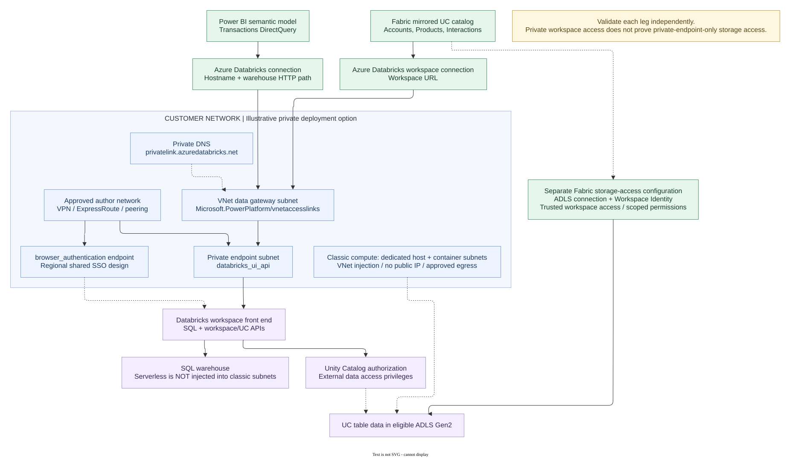

# Azure Databricks through a VNet and Private Link

[Home](../README.md) | [Deployment](deployment.md) | [Source setup](sources.md)

**Status:** documented deployment option; not part of the validated
public-connectivity baseline. Official guidance reviewed
**23 November 2026**. Re-check product availability, region and tenant settings
before design approval.

## Four different networking problems

| Requirement | Relevant mechanism | What it does NOT do |
|---|---|---|
| Place classic Databricks compute in controlled subnets | **VNet injection + secure cluster connectivity** | Does not inject serverless SQL compute into those subnets |
| Privately reach Databricks workspace/API/SQL front end | **Inbound Private Link + private DNS** | Does not give Power BI SaaS automatic access to the private IP |
| Let Power BI/Fabric access that private front end | **VNet data gateway + correctly typed connection** | Does not automatically configure UC/ADLS storage access |
| Let Fabric read UC table storage protected by a firewall | **ADLS connection + Workspace Identity/trusted workspace access**, per current mirror guide | Is not the same as using Private Link for every storage packet |

There are **two Databricks connections** in this solution:

1. **Azure Databricks**: hostname + SQL warehouse HTTP path, for Transactions DQ.
2. **Azure Databricks workspace**: workspace URL, for mirrored UC catalog access.

## 1. Design and allocate networking

Use Premium Databricks and a VNet in the same subscription/region as the
workspace, following the current
[VNet-injection guide](https://learn.microsoft.com/en-us/azure/databricks/security/network/classic/vnet-inject).
Coordinate IP space with the network team; this is an **illustrative**, not
prescriptive, allocation:

| Subnet | Example CIDR | Delegation / use |
|---|---|---|
| `dbx-host` | `10.70.0.0/26` | `Microsoft.Databricks/workspaces` |
| `dbx-container` | `10.70.0.64/26` | `Microsoft.Databricks/workspaces` |
| `private-endpoints` | `10.70.1.0/27` | Databricks private endpoint NICs; no Databricks/PowerPlatform delegation |
| `fabric-vnet-gateway` | `10.70.2.0/27` | `Microsoft.PowerPlatform/vnetaccesslinks`; dedicated to this service |

The two Databricks subnets must be equal size; `/26` or larger is recommended.
The host subnet may be labelled "public" in the UI: with secure cluster
connectivity/no-public-IP enabled, both use private IPs. Do not interpret its
name as permission to expose cluster NICs.

- Deploy secure cluster connectivity (`enableNoPublicIp=true`).
- Preserve Databricks-managed NSG rules.
- Plan explicit outbound connectivity through NAT Gateway or an approved
  firewall/UDR architecture. New VNets after 31 March 2026 require an explicit
  outbound method. No-public-IP compute still needs required service access.
- Peering, route tables and DNS must cover the gateway, endpoint and authoring
  locations. VNet peering alone does not provide private DNS resolution.
- Plan firewall, DNS, gateway and private-endpoint ownership and recurring costs.

**Serverless:** the original SQL warehouse was serverless. Serverless compute
runs in the Databricks-managed serverless compute plane, not these injected
subnets. For serverless outbound access to your storage, review serverless
network connectivity configurations and serverless private endpoints
separately. Inbound Private Link to the SQL service and serverless outbound
storage access are distinct controls.

## 2. Configure workspace Private Link and private DNS

Follow the current
[inbound Private Link deployment guide](https://learn.microsoft.com/en-us/azure/databricks/security/network/front-end/front-end-private-connect).

1. Start with an approved private-link-capable workspace configuration. For an
   existing workspace, plan the documented downtime/compute-stop sequence.
2. Create and approve a private endpoint with subresource
   **`databricks_ui_api`** in a suitable transit/private-endpoint subnet.
3. Integrate **`privatelink.azuredatabricks.net`** with private DNS. Link the zone
   to consuming VNets or configure approved DNS forwarding.
4. For browser SSO over the private path, configure
   **`browser_authentication`** as documented, preferably in a separate stable
   authentication workspace. Only one such endpoint per Azure region/private
   DNS zone is allowed; it can serve multiple workspaces in that scope.
5. From a routable host, verify workspace hostname resolution to the expected
   private IP and TCP 443 connectivity. Keep using the normal workspace hostname
   in connections, not the raw private IP.
6. Validate user login, SQL queries and gateway connections while the approved
   rollout state still allows recovery.
7. Disable public network access only after all required private paths work.
   Review public-access tests from an outside network; an old browser session
   is not a sufficient negative test.

The browser-authentication endpoint is not a SQL warehouse and does not replace
Entra app permissions or table privileges.

## 3. Create the Fabric VNet data gateway

Follow [Create VNet data gateways](https://learn.microsoft.com/en-us/data-integration/vnet/create-data-gateways):

1. Register Azure provider **Microsoft.PowerPlatform** in the subscription.
2. Use a **dedicated, non-IPv6 subnet** with
   `Microsoft.PowerPlatform/vnetaccesslinks` delegation. Do not use the
   Databricks subnets, the endpoint subnet, `GatewaySubnet` or `AzureBastionSubnet`.
3. Configure required service endpoints including `Microsoft.AzureActiveDirectory`
   and `Microsoft.Storage` as documented.
4. Ensure gateway members can communicate within the subnet; the current guide
   calls out TCP 10065 at minimum. Follow its full intra-subnet policy guidance.
5. Grant the operator the required
   `Microsoft.Network/virtualNetworks/subnets/join/action` permission.
6. In Fabric **Settings > Manage connections and gateways > Virtual network
   data gateways > New**, choose capacity, subscription, VNet and subnet.
7. For private UC mirroring, place the gateway in the **same region as
   Databricks**, with a route to the private endpoint.

The current gateway licensing guide lists any Fabric SKU or supported Premium
capacities; check regional availability and gateway capacity charges. The
gateway's runtime region and the tenant's metadata/home region can differ.

## 4A. Connect DirectQuery Transactions privately

1. In **Manage connections and gateways**, create a **Virtual network**
   connection using the new gateway.
2. Select **Azure Databricks**; enter workspace server hostname and warehouse
   HTTP path. Do not select the "workspace" catalog-mirroring connector.
3. Authenticate using the approved identity method available for that connector.
   Grant warehouse CAN USE, USE CATALOG, USE SCHEMA and SELECT.
4. Map `sm_client_analytics`'s Databricks source to the new connection.
5. Query Transactions independently; compare counts and totals with Databricks.
6. Test a large result path and source concurrency, not just `SELECT 1`.

**CloudFetch:** large query results may be fetched from workspace storage.
Validate the storage DNS/firewall/route from the gateway as well as the workspace
API. Current connector guidance calls out blob/store endpoints and certificate
revocation access. If CloudFetch is deliberately disabled using
`EnableQueryResultDownload=0`, document and performance-test that trade-off;
do not disable it silently to hide a network defect.

An appropriately configured standard on-premises gateway on a VNet-reachable
machine is a connector-supported alternative for some **Power BI SQL/Databricks
query scenarios**. It is **not** the supported replacement for the private
mirrored-catalog gateway below.

## 4B. Connect the mirrored UC catalog privately

Current Microsoft guidance explicitly supports
[Mirrored Azure Databricks behind a private endpoint](https://learn.microsoft.com/en-us/fabric/mirroring/azure-databricks-private-endpoint).
Older blanket claims that private workspaces are unsupported are outdated.

1. Open **Manage connections and gateways > New > Virtual network**.
2. Select the VNet gateway, connection type **Azure Databricks workspace**,
   and workspace URL.
3. Choose organizational-account or service-principal authentication as
   permitted by the current connector and your policy.
4. **Create this connection first.** The current mirror creation flow has a
   known limitation: it cannot create the necessary VNet connection inline.
5. Create the mirrored catalog and choose the existing connection.
6. Confirm external data access, `EXTERNAL USE SCHEMA`, table access and the
   three intended table selections.

Only the **VNet data gateway** is supported for this private mirrored-catalog
workspace leg; the on-premises gateway is explicitly unsupported.

### Secure the ADLS table-storage leg too

Follow the current
[mirroring tutorial's network-security section](https://learn.microsoft.com/en-us/fabric/mirroring/azure-databricks-tutorial#enable-network-security-access-for-your-azure-data-lake-storage-gen2-account)
and [trusted workspace access](https://learn.microsoft.com/en-us/fabric/security/security-trusted-workspace-access).

- Establish the Fabric Workspace Identity and appropriate ADLS connection.
- For firewall-protected ADLS, Fabric uses **Workspace Identity** to traverse
  the firewall regardless of the Databricks connection's authentication method.
- Allow the workspace with the documented resource-instance rule/trusted
  workspace access configuration.
- Grant the chosen data-access identity scoped Storage Blob Data Reader, or
  the documented read/execute ACLs at folder level with execute on parent paths.
- Check each backing storage account. Matching one account does not cover UC
  tables in other storage accounts.
- Apply OneLake data access roles and keep group/table permissions aligned.

The current tutorial's firewall section is for eligible **ADLS Gen2 table
storage** and explicitly says firewall-protected **Azure Databricks workspace
storage** is unsupported in that mirroring scenario. Do not conflate these
accounts or apply a blanket storage lockdown based on the SQL connector's
CloudFetch guidance. Confirm where the three UC tables physically reside.

**Security claim boundary:** trusted workspace access through a firewall is not
proof that every storage hop uses a private endpoint. If policy requires
private-endpoint-only traffic with public storage endpoints disabled, obtain
explicit product/network validation for that exact configuration. Do not claim
that the workspace VNet gateway tunnels every downstream shortcut read.

## 5. Acceptance matrix before public access is disabled

| Test | Evidence required |
|---|---|
| DNS and routing | Workspace hostname resolves privately from the gateway-connected network |
| Browser access | Intended Entra login works from approved client networks |
| Warehouse access | Source count/financial query succeeds using the intended query identity |
| DirectQuery | Power BI Transactions result equals source; large result query works |
| UC catalog | Fabric lists the three selected UC tables through the pre-created VNet connection |
| Storage access | Spark reads all three table contents; no masked 403/timeout |
| Silver/Gold | Both notebooks record PASSED with correct layer/run IDs |
| Negative access | Unapproved user/network cannot read the protected source |
| Public block | Required features remain usable after the approved public-access change |
| Recovery | Documented owner, rollback path, logs and support evidence |

Do not reuse an existing browser-authentication endpoint/workspace without its
owner's approval, and never delete that shared workspace when decommissioning this solution.

## Troubleshooting by symptom

| Symptom | Start with |
|---|---|
| Workspace hostname resolves publicly | Private zone link/forwarder and client resolver |
| TCP timeout | Peering, UDR, NSG/firewall and endpoint approval |
| OAuth works but SQL fails | Warehouse permission/state; correct HTTP path |
| Small SQL succeeds, large result fails | CloudFetch storage and certificate/network paths |
| Private mirrored connection missing from picker | Create it first in Manage connections; use workspace connector |
| Metadata lists but Spark gets storage 403 | Workspace Identity resource-instance rule, ADLS role/ACL, storage-account match |
| Serverless cannot reach storage | Serverless network connectivity config, not classic subnet injection |

Keep tokens/passwords out of screenshots, support tickets, source control and
diagnostic captures.
